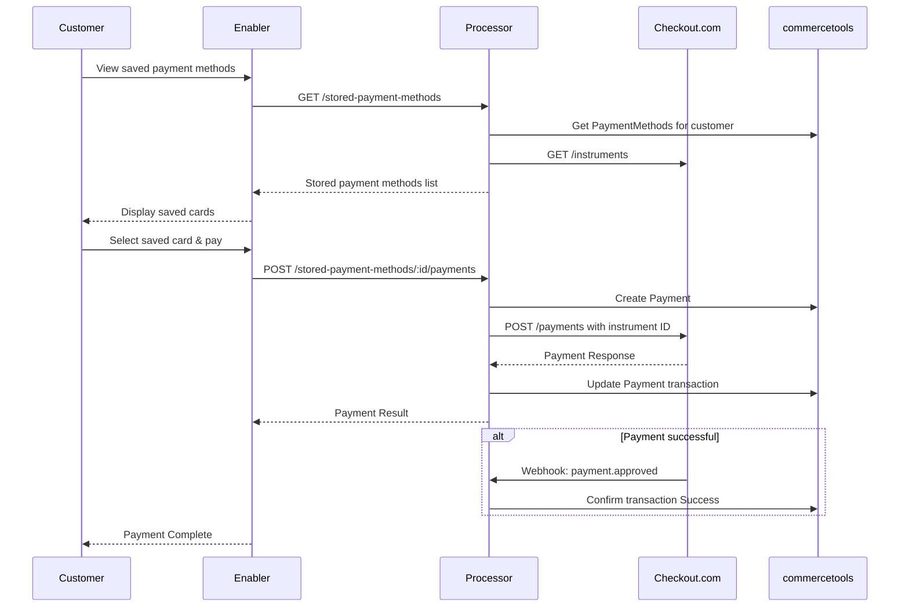
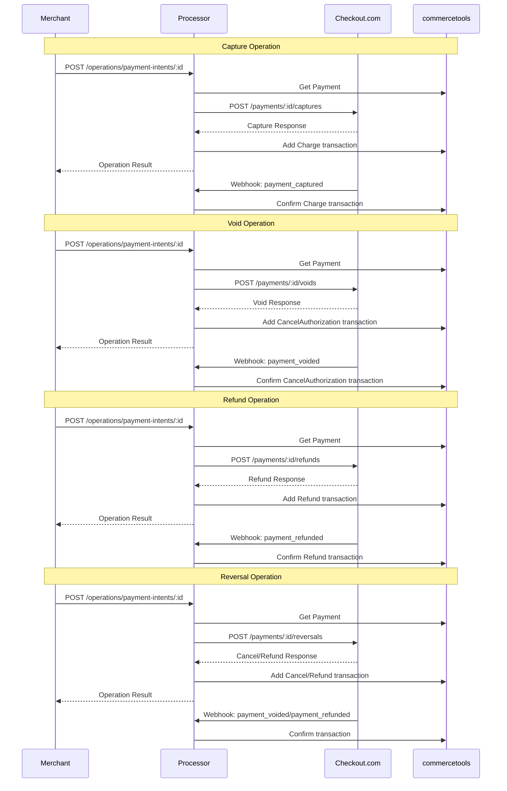
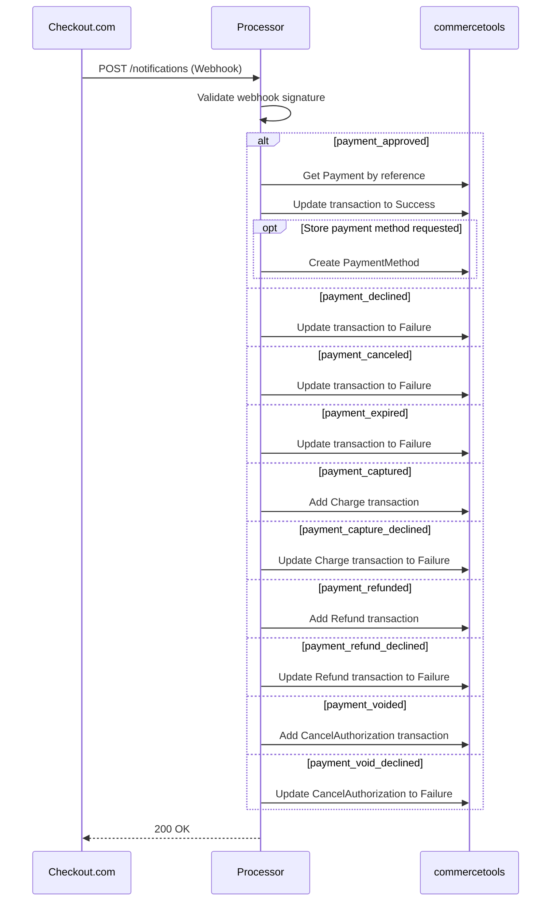
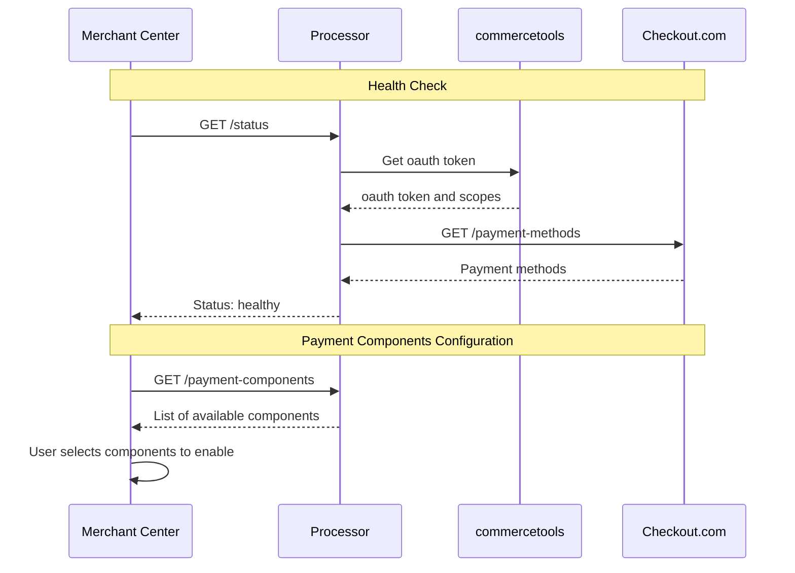

# Checkout.com connector for commercetools Checkout

This repository provides a commercetools Checkout integration for [Checkout.com](https://www.checkout.com/), enabling a comprehensive payment experience through Checkout.com Web Components and supporting payment sessions, stored payment methods, payment operations, and webhook handling.

## Features

- **Payment Components**: Pre-built, customizable web components powered by [Checkout.com Flow](https://www.checkout.com/docs/payments/accept-payments/accept-a-payment-on-your-website/get-started-with-flow) library, supporting multiple payment methods including cards, digital wallets (Apple Pay, Google Pay, PayPal), and regional payment methods (Klarna, SEPA, iDEAL, etc.).
- **Stored Payment Methods**: Tokenization and management of saved payment methods for returning customers. Customers can pay using previously saved cards and payment instruments. The connector stores references to Checkout.com payment instruments in commercetools, but does not store any sensitive card data or tokens locally—all tokenization is handled securely by Checkout.com.
- **Payment Modifications**: Full support for authorization, capture, void, refund, and reverse operations.
- **Webhook Integration**: Real-time payment status updates via Checkout.com webhook notifications.
- **Multi-Channel Configuration**: Support for multiple Checkout.com channel configurations based on cart context.
- **Seamless commercetools Integration**: Automatic synchronization and registration of all payment data, transactions, and events in commercetools, enabling easy integration with your existing commerce workflows.

## Supported Payment Methods

The connector supports the following payment methods through Checkout.com:

- **Cards** (Visa, Mastercard, Amex, Discover, Diners Club, etc.) with 3D Secure authentication and tokenization support
- **Apple Pay**
- **Google Pay**
- **PayPal**
- **Klarna**
- **Alma**
- **SEPA Direct Debit**
- **iDEAL**
- **EPS**
- **Przelewy24**
- **ACH**
- **Bizum**
- **MB WAY**

> **Note**: Payment method availability may vary depending on your Checkout.com account configuration, merchant location, and transaction currency. Please refer to [Checkout.com documentation](https://docs.checkout.com/) for specific requirements and regional availability.

## Architecture Overview

The connector consists of two main modules:

### Enabler (Frontend)

- Renders Checkout.com Flow web components for each payment method
- Provides stored payment methods data and API for integration
- Handles communication with the processor backend to process payments

### Processor (Backend)

- Middleware for Checkout.com API integration
- Handles payment modifications (capture, void, refund, reverse)
- Processes webhook events and updates payment states
- Stores and manages tokenized payment methods
- Updates commercetools payment entities
- Supports multi-channel Checkout.com configurations

### Integration Flows

The following diagrams detail the main integration flows between the connector components, Checkout.com, and commercetools.

#### Regular payment


#### Payment with stored payment method



#### Payment modifications



#### Webhook payment updates



#### Merchant Center Integration



## Prerequisites

### 1. Checkout.com Account

Create a Checkout.com account. You'll need:

- **Public Key**: For frontend Payment Element initialization
- **Secret Key**: For backend API calls
- **Processing Channel ID**: One or more processing channels
- **Webhook Signing Secret**: For webhook signature validation

Configure webhooks in your Checkout.com dashboard to point to your processor endpoint `/notifications`. The processor URL can be obtained from the commercetools Merchant Center or via commercetools Connect API.
The connector processes the following webhook events:

- **payment_approved**: Updates Authorization transaction to Success, optionally saves payment method
- **payment_declined**: Updates Authorization transaction to Failure
- **payment_canceled**: Updates Authorization transaction to Failure
- **payment_expired**: Updates Authorization transaction to Failure
- **payment_captured**: Creates Charge transaction with Success state
- **payment_capture_declined**: Updates Charge transaction to Failure
- **payment_refunded**: Creates Refund transaction with Success state
- **payment_refund_declined**: Updates Refund transaction to Failure
- **payment_voided**: Creates CancelAuthorization transaction with Success state
- **payment_void_declined**: Updates CancelAuthorization transaction to Failure

### 2. commercetools Composable Commerce API Client

Create an API client with the following scopes:

- `manage_payments`
- `manage_orders`
- `view_sessions`
- `view_api_clients`
- `manage_checkout_payment_intents`
- `introspect_oauth_tokens`
- `manage_types`
- `manage_types`
- `view_customers`
- `manage_payment_methods`

### 3. Connector Deployment

Deploy the connector to your commercetools project using the [commercetools Connect Deployment API](https://docs.commercetools.com/connect/deployments).

The connector requires the following configuration specified in the `connect.yaml` file:

```yaml
deployAs:
  - name: enabler
    applicationType: assets
  - name: processor
    applicationType: service
    endpoint: /
    scripts:
      postDeploy: npm install && npm run connector:post-deploy
      preUndeploy: npm install && npm run connector:pre-undeploy
    configuration:
      standardConfiguration:
        - key: CTP_PROJECT_KEY
          description: commercetools project key
          required: true
        - key: CTP_AUTH_URL
          description: commercetools Auth URL
          required: true
          default: https://auth.europe-west1.gcp.commercetools.com
        - key: CTP_API_URL
          description: commercetools API URL
          required: true
          default: https://api.europe-west1.gcp.commercetools.com
        - key: CTP_SESSION_URL
          description: Session API URL
          required: true
          default: https://session.europe-west1.gcp.commercetools.com
        - key: CTP_JWKS_URL
          description: JWKs URL for JWT validation
          required: true
          default: https://mc-api.europe-west1.gcp.commercetools.com/.well-known/jwks.json
        - key: CTP_JWT_ISSUER
          description: JWT Issuer for JWT validation
          required: true
          default: https://mc-api.europe-west1.gcp.commercetools.com
        - key: HEALTH_CHECK_TIMEOUT
          description: Health check timeout in milliseconds
          default: "10000"
        - key: LOGGER_LEVEL
          description: Logger level (error, warn, info, debug)
          default: info
        - key: MERCHANT_RETURN_URL
          description: URL to redirect customers after payment
          required: true
        - key: CKO_ENVIRONMENT
          description: Checkout.com environment (sandbox or production)
          required: true
          default: sandbox
      securedConfiguration:
        - key: CTP_CLIENT_SECRET
          description: commercetools client secret
          required: true
        - key: CTP_CLIENT_ID
          description: commercetools client ID
          required: true
        - key: CKO_CONFIG
          description: |
            Checkout.com configuration as JSON string.
            For single channel: {"publicKey":"pk_xxx","secretKey":"sk_xxx","webhookSigningSecret":"whsec_xxx"}
            For multi-channel: {"channels":[{"key":"default","publicKey":"pk_xxx","secretKey":"sk_xxx","webhookSigningSecret":"whsec_xxx"}],"channelKey":"custom.fields.channelKey"}
          required: true
```

### Configuration Variables

The following variables must be configured when deploying the connector:

#### commercetools Configuration

- **CTP_PROJECT_KEY**: Your commercetools project key
- **CTP_CLIENT_ID**: API client ID with required scopes
- **CTP_CLIENT_SECRET**: API client secret (secured)
- **CTP_API_URL**: commercetools API URL (default: `https://api.europe-west1.gcp.commercetools.com`)
- **CTP_AUTH_URL**: commercetools Auth URL (default: `https://auth.europe-west1.gcp.commercetools.com`)
- **CTP_SESSION_URL**: commercetools Session URL (default: `https://session.europe-west1.gcp.commercetools.com`)
- **CTP_JWKS_URL**: JWKs URL for JWT validation (default: `https://mc-api.europe-west1.gcp.commercetools.com/.well-known/jwks.json`)
- **CTP_JWT_ISSUER**: JWT issuer (default: `https://mc-api.europe-west1.gcp.commercetools.com`)

> **Note**: The `CTP_API_URL`, `CTP_AUTH_URL`, and `CTP_SESSION_URL` values depend on your commercetools project region. The examples above are for the `europe-west1.gcp` region. Adjust these URLs according to your project's region (e.g., `us-central1.gcp`, `eu-central-1.aws`, etc.).

#### Checkout.com Configuration

- **CKO_CONFIG** (secured): JSON configuration for Checkout.com integration. Supports single or multi-channel setups.

  The configuration always includes a `default` channel that is used when no specific channel matches the request context. Additional channels can be configured for multi-store or multi-region scenarios.

  **Channel Selection**: The connector uses the `channelPath` JSONata expression to extract a channel key from the cart/order context. If a matching channel is found in the `channels` array, its configuration is used; otherwise, the `default` channel configuration is applied.

  **Configuration Fields:**

  - **default** (required): Default channel configuration object with the following fields:

    - `key`: Unique identifier for the channel
    - `channelId`: Checkout.com channel ID from merchant portal
    - `publicKey`: Public API key for client-side operations
    - `secretKey`: Secret API key for server-side operations
    - `hmacKey`: HMAC secret key for webhook signature validation
    - `captureDelayHours` (optional): Hours to delay automatic capture after authorization (0 = immediate capture). If not defined, the payment will require manual capture
    - `enableThreeDS` (optional): Enable 3D Secure authentication for card payments. Default: true
    - `storedPaymentMethodsEnabled` (optional): Enable stored payment methods support. Default: true
    - `paymentInterface` (optional): Payment interface identifier. This identifies this connector as the processor of a commercetools payment. Default: "checkout-cko"
    - `interfaceAccount` (optional): Interface account name (e.g., store name). If not provided, the channel ID will be used
    - `saveInterfaceInteractions` (optional): Save interface interactions for payment operations. This stores the requests and responses sent to and received from Checkout.com in the commercetools payment. Default: true
    - `savePaymentMethodAdditionalDetails` (optional): Save additional payment method details (e.g., card brand, last4). Default: true

  - **channelPath** (optional): Path expression to extract channel key from cart/order context. Default: "store.key"

    This allows you to use a single connector deployment for multiple stores or regions, each with its own Checkout.com account. For example, if you have a US store and a UK store, each with different Checkout.com accounts, you can configure both in the same connector and let it automatically route to the correct account based on the cart's store context.

    Examples:

    - `"store.key"` → extracts from `cart.store.key`
    - `"custom.fields.region"` → extracts from `cart.custom.fields.region`

  - **channels** (optional): Array of additional channel configurations. Each channel has the same structure as the `default` channel.

  > **Note**: When a request is processed, the connector evaluates the `channelPath` expression against the cart/order to determine which channel configuration to use. If the extracted value matches a channel `key` in the `channels` array, that channel's configuration is used. Otherwise, the `default` channel configuration is applied.

  **Single Channel Example:**

  ```json
  {
    "default": {
      "key": "default",
      "channelId": "ch_xxxxx",
      "publicKey": "pk_sbox_xxxxx",
      "secretKey": "sk_sbox_xxxxx",
      "hmacKey": "whsec_xxxxx",
      "captureDelayHours": 0,
      "enableThreeDS": true,
      "storedPaymentMethodsEnabled": true,
      "paymentInterface": "checkout-cko",
      "saveInterfaceInteractions": true,
      "savePaymentMethodAdditionalDetails": true
    }
  }
  ```

  **Multi-Channel Example:**

  ```json
  {
    "default": {
      "key": "default",
      "channelId": "ch_default",
      "publicKey": "pk_sbox_default",
      "secretKey": "sk_sbox_default",
      "hmacKey": "whsec_default",
      "captureDelayHours": 0,
      "enableThreeDS": true,
      "storedPaymentMethodsEnabled": true,
      "paymentInterface": "checkout-cko"
    },
    "channelPath": "store.key",
    "channels": [
      {
        "key": "eu-store",
        "channelId": "ch_eu_xxxxx",
        "publicKey": "pk_sbox_eu_xxxxx",
        "secretKey": "sk_sbox_eu_xxxxx",
        "hmacKey": "whsec_eu_xxxxx",
        "captureDelayHours": 168,
        "enableThreeDS": true,
        "storedPaymentMethodsEnabled": true,
        "paymentInterface": "checkout-cko",
        "interfaceAccount": "EU-Store",
        "saveInterfaceInteractions": true,
        "savePaymentMethodAdditionalDetails": true
      },
      {
        "key": "us-store",
        "channelId": "ch_us_xxxxx",
        "publicKey": "pk_sbox_us_xxxxx",
        "secretKey": "sk_sbox_us_xxxxx",
        "hmacKey": "whsec_us_xxxxx",
        "captureDelayHours": 0,
        "enableThreeDS": false,
        "storedPaymentMethodsEnabled": false,
        "paymentInterface": "checkout-cko",
        "interfaceAccount": "US-Store"
      }
    ]
  }
  ```

- **CKO_ENVIRONMENT**: Checkout.com environment
  - `sandbox`: For testing
  - `production`: For live payments

#### Application Configuration

- **HEALTH_CHECK_TIMEOUT**: Timeout for health checks in milliseconds (default: `10000`)
- **LOGGER_LEVEL**: Logging level - `error`, `warn`, `info`, or `debug` (default: `info`)
- **MERCHANT_RETURN_URL**: URL to redirect customers after payment completion (required)

## Development

### Environment Setup

1. **Clone the repository**

   ```bash
   git clone <repository-url>
   cd connect-payment-integration-cko
   ```

2. **Set up environment variables**

   For the processor:

   ```bash
   cd processor
   cp .env.template .env
   # Edit .env with your credentials
   ```

   For the enabler:

   ```bash
   cd ../enabler
   cp .env.template .env
   # Edit .env with your credentials
   ```

3. **Install dependencies**
   ```bash
   # From root directory
   npm install
   ```

### Running with Docker Compose

Start all services (JWT server, processor, enabler):

```bash
docker compose up
```

This starts:

- **JWT Server**: http://localhost:9002
- **Processor**: http://localhost:8080
- **Enabler**: http://localhost:3000

### Local Development

#### Processor

```bash
cd processor
npm install
npm run dev
```

#### Enabler

```bash
cd enabler
npm install
npm run dev
```

### Testing

```bash
# Run all tests
npm test

# Run tests in watch mode
npm run test:watch
```

### Code Quality

```bash
# Lint code
npm run lint

# Fix linting issues
npm run lint:fix
```

## License

This project is licensed under the MIT License - see the [LICENSE](LICENSE) file for details.
