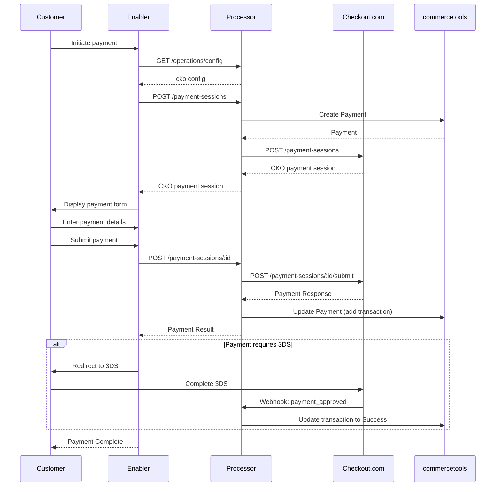
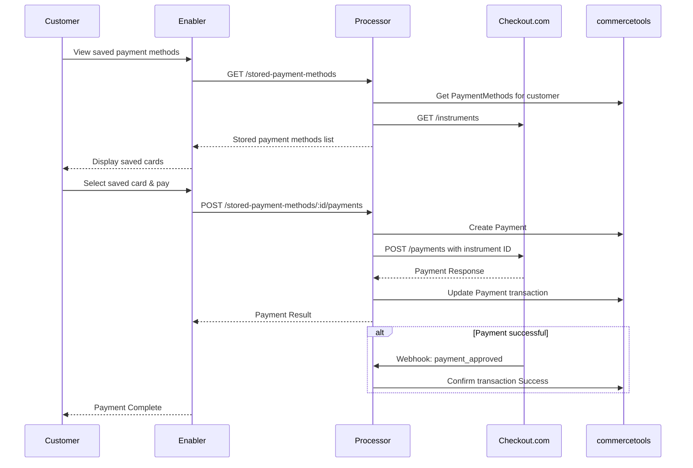
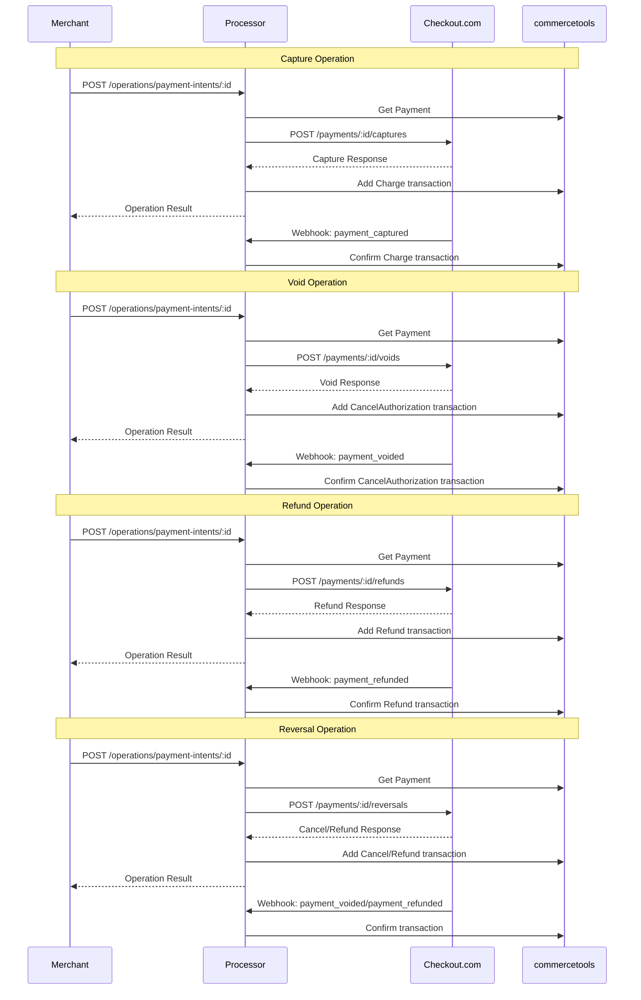
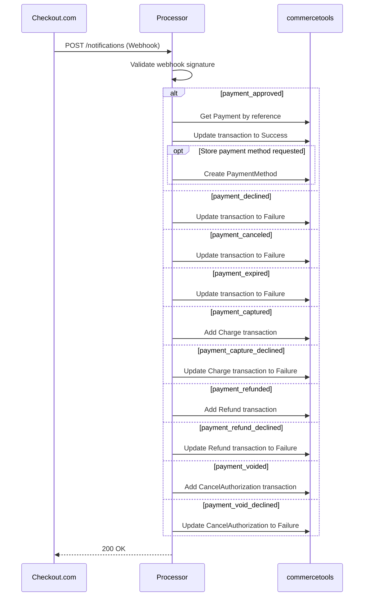
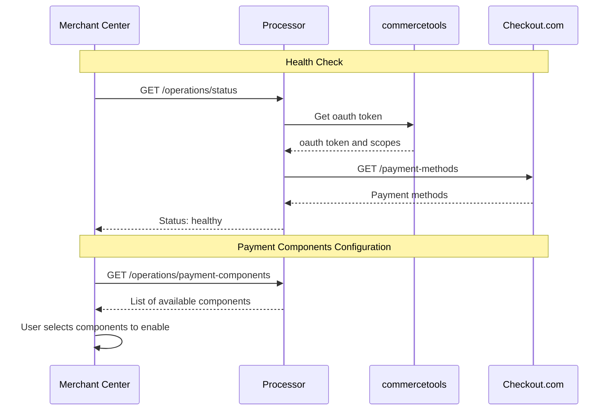

# Checkout.com connector for commercetools Checkout

This repository contains a commercetools Checkout integration for [Checkout.com](https://www.checkout.com/). It uses the Checkout.com Flow web components. It supports payment sessions, stored payment methods, payment operations, and webhook handling.

## Features

- Payment components: Checkout.com Flow web components for cards, digital wallets (Apple Pay, Google Pay, PayPal), and regional payment methods (Klarna, SEPA, iDEAL, and others).
- Stored payment methods: customers can save a payment method and pay with it later. The connector stores references to Checkout.com payment instruments in commercetools. It does not store card data or tokens locally. Checkout.com does the tokenization.
- Payment modifications: capture, void, refund, and reverse.
- Webhook integration: Checkout.com webhook notifications update the payment status.
- Multi-channel configuration: the connector can use several Checkout.com channel configurations, selected from the cart context.
- commercetools synchronization: the processor records payment data, transactions, and events in commercetools.

## Supported Payment Methods

The connector supports the following payment methods through Checkout.com:

- **ACH**
- **Alma**
- **Apple Pay**
- **Bizum**
- **Cards** (Visa, Mastercard, Amex, Discover, Diners Club, etc.) with 3D Secure authentication and tokenization support
- **EPS**
- **Google Pay**
- **iDEAL**
- **Klarna**
- **MB WAY**
- **PayPal**
- **Przelewy24**
- **SEPA Direct Debit**
- **Vipps**

Payment method availability depends on your Checkout.com account configuration, merchant location, and transaction currency. For requirements and regional availability, see the [Checkout.com documentation](https://docs.checkout.com/).

## Architecture Overview

The connector consists of two main modules:

### Enabler (Frontend)

- Renders Checkout.com Flow web components for each payment method
- Provides data and an API for stored payment methods
- Handles communication with the processor backend to process payments

### Processor (Backend)

- Middleware for Checkout.com API integration
- Handles payment modifications (capture, void, refund, reverse)
- Processes webhook events and updates payment states
- Stores and manages references to tokenized payment methods
- Updates commercetools payment entities
- Supports multi-channel Checkout.com configurations

### Integration Flows

The following diagrams detail the main integration flows between the connector components, Checkout.com, and commercetools.

#### Regular payment



#### Payment with stored payment method



#### Payment modifications



#### Webhook payment updates



#### Merchant Center Integration



## Prerequisites

### 1. Checkout.com account

Create a Checkout.com account. You need these values for each channel:

- Public key: used by the enabler to start the Flow components.
- Secret key: used by the processor for API calls.
- Channel ID: the Checkout.com processing channel.
- HMAC key: the webhook signing secret. The processor uses it to validate webhook signatures.

In the Checkout.com dashboard, set the webhook URL to the `/notifications` endpoint of your processor. You can get the processor URL from the commercetools Merchant Center or from the commercetools Connect API.

The connector processes these webhook events:

- `payment_approved`: sets the Authorization transaction to Success. It can also save the payment method.
- `payment_declined`: sets the Authorization transaction to Failure.
- `payment_canceled`: sets the Authorization transaction to Failure.
- `payment_expired`: sets the Authorization transaction to Failure.
- `payment_captured`: creates a Charge transaction with state Success.
- `payment_capture_declined`: sets the Charge transaction to Failure.
- `payment_refunded`: creates a Refund transaction with state Success.
- `payment_refund_declined`: sets the Refund transaction to Failure.
- `payment_voided`: creates a CancelAuthorization transaction with state Success.
- `payment_void_declined`: sets the CancelAuthorization transaction to Failure.

### 2. commercetools API client

Create an API client with these scopes:

- `manage_payments`
- `manage_orders`
- `view_sessions`
- `view_api_clients`
- `manage_checkout_payment_intents`
- `introspect_oauth_tokens`
- `manage_types`
- `view_customers`
- `manage_payment_methods`

The `GET /operations/status` endpoint makes sure that the API client has these scopes.

### 3. Connector deployment

Deploy the connector to your commercetools project with the [commercetools Connect Deployment API](https://docs.commercetools.com/connect/deployments).

The file [connect.yaml](connect.yaml) defines the deployment and all configuration variables. It deploys the `enabler` as an `assets` application and the `processor` as a `service` application. The `postDeploy` script creates the custom types that the connector needs. The `preUndeploy` script does nothing yet.

### Configuration variables

Set these variables when you deploy the connector. The `connect.yaml` file is the source of truth for the defaults.

#### commercetools Configuration

- **CTP_PROJECT_KEY**: your commercetools project key
- **CTP_CLIENT_ID**: API client ID with the required scopes
- **CTP_CLIENT_SECRET**: API client secret (secured)
- **CTP_API_URL**: commercetools API URL (default: `https://api.europe-west1.gcp.commercetools.com`)
- **CTP_AUTH_URL**: commercetools Auth URL (default: `https://auth.europe-west1.gcp.commercetools.com`)
- **CTP_SESSION_URL**: commercetools Session URL (default: `https://session.europe-west1.gcp.commercetools.com`)
- **CTP_CHECKOUT_URL**: commercetools Checkout URL (default: `https://checkout.europe-west1.gcp.commercetools.com`)
- **CTP_JWKS_URL**: JWKs URL for JWT validation (default: `https://mc-api.europe-west1.gcp.commercetools.com/.well-known/jwks.json`)
- **CTP_JWT_ISSUER**: JWT issuer (default: `https://mc-api.europe-west1.gcp.commercetools.com`)

The `CTP_API_URL`, `CTP_AUTH_URL`, `CTP_SESSION_URL`, and `CTP_CHECKOUT_URL` values depend on your commercetools project region. The examples above are for the `europe-west1.gcp` region. Change these URLs to match the region of your project, for example `us-central1.gcp` or `eu-central-1.aws`.

#### Checkout.com Configuration

- **CKO_CONFIG** (secured): JSON configuration for Checkout.com integration. Supports single or multi-channel setups. Each channel can have the Checkout.com `clientId`. With it, the connector calls the merchant-specific hosts of Checkout.com (MSSD).

  The configuration always includes a `default` channel that is used when no specific channel matches the request context. Additional channels can be configured for multi-store or multi-region scenarios.

  **Channel Selection**: The connector uses the `channelPath` JSONata expression to extract a channel key from the cart/order context. If a matching channel is found in the `channels` array, its configuration is used; otherwise, the `default` channel configuration is applied.

  **Configuration Fields:**

  - **default** (required): Default channel configuration object with the following fields:

    - `key`: Unique identifier for the channel
    - `channelId`: Checkout.com channel ID from merchant portal
    - `publicKey`: Public API key for client-side operations
    - `secretKey`: Secret API key for server-side operations
    - `hmacKey`: HMAC secret key for webhook signature validation
    - `clientId` (optional): Checkout.com client ID (`cli_...`) of this merchant for the configured `CKO_ENVIRONMENT`. For details, see [processor/README.md](processor/README.md)
    - `apiBaseUrl` (optional): Explicit Checkout.com API base URL override (e.g. `https://abcd1234.api.checkout.com`)
    - `accessBaseUrl` (optional): Explicit Checkout.com Access (OAuth) base URL override (e.g. `https://abcd1234.access.checkout.com`)
    - `captureDelayHours` (optional): Hours to delay automatic capture after authorization (0 = immediate capture). If not defined, the payment will require manual capture
    - `enableThreeDS` (optional): Enable 3D Secure authentication for card payments. Default: true
    - `storedPaymentMethodsEnabled` (optional): Enable stored payment methods support. Default: true
    - `paymentInterface` (optional): Payment interface identifier. This identifies this connector as the processor of a commercetools payment. Default: "checkout-cko"
    - `interfaceAccount` (optional): Interface account name (e.g., store name). If not provided, the channel ID will be used
    - `saveInterfaceInteractions` (optional): Save interface interactions for payment operations. This stores the requests and responses sent to and received from Checkout.com in the commercetools payment. Default: true
    - `savePaymentMethodAdditionalDetails` (optional): Save additional payment method details (e.g., card brand, last4). Default: true

  - **channelPath** (optional): Path expression to extract channel key from cart/order context. Default: "store.key"

    This allows you to use a single connector deployment for multiple stores or regions, each with its own Checkout.com account. For example, if you have a US store and a UK store, each with different Checkout.com accounts, you can configure both in the same connector and let it automatically route to the correct account based on the cart's store context.

    Examples:

    - `"store.key"` → extracts from `cart.store.key`
    - `"custom.fields.region"` → extracts from `cart.custom.fields.region`

  - **channels** (optional): Array of additional channel configurations. Each channel has the same structure as the `default` channel.

  > **Note**: When a request is processed, the connector evaluates the `channelPath` expression against the cart/order to determine which channel configuration to use. If the extracted value matches a channel `key` in the `channels` array, that channel's configuration is used. Otherwise, the `default` channel configuration is applied.

  **Single Channel Example:**

  ```json
  {
    "default": {
      "key": "default",
      "channelId": "ch_xxxxx",
      "publicKey": "pk_sbox_xxxxx",
      "secretKey": "sk_sbox_xxxxx",
      "hmacKey": "whsec_xxxxx",
      "captureDelayHours": 0,
      "enableThreeDS": true,
      "storedPaymentMethodsEnabled": true,
      "paymentInterface": "checkout-cko",
      "saveInterfaceInteractions": true,
      "savePaymentMethodAdditionalDetails": true
    }
  }
  ```

  **Multi-Channel Example:**

  ```json
  {
    "default": {
      "key": "default",
      "channelId": "ch_default",
      "publicKey": "pk_sbox_default",
      "secretKey": "sk_sbox_default",
      "hmacKey": "whsec_default",
      "captureDelayHours": 0,
      "enableThreeDS": true,
      "storedPaymentMethodsEnabled": true,
      "paymentInterface": "checkout-cko"
    },
    "channelPath": "store.key",
    "channels": [
      {
        "key": "eu-store",
        "channelId": "ch_eu_xxxxx",
        "publicKey": "pk_sbox_eu_xxxxx",
        "secretKey": "sk_sbox_eu_xxxxx",
        "hmacKey": "whsec_eu_xxxxx",
        "captureDelayHours": 168,
        "enableThreeDS": true,
        "storedPaymentMethodsEnabled": true,
        "paymentInterface": "checkout-cko",
        "interfaceAccount": "EU-Store",
        "saveInterfaceInteractions": true,
        "savePaymentMethodAdditionalDetails": true
      },
      {
        "key": "us-store",
        "channelId": "ch_us_xxxxx",
        "publicKey": "pk_sbox_us_xxxxx",
        "secretKey": "sk_sbox_us_xxxxx",
        "hmacKey": "whsec_us_xxxxx",
        "captureDelayHours": 0,
        "enableThreeDS": false,
        "storedPaymentMethodsEnabled": false,
        "paymentInterface": "checkout-cko",
        "interfaceAccount": "US-Store"
      }
    ]
  }
  ```

- **CKO_ENVIRONMENT** (required): Checkout.com environment. Use `sandbox` for tests and `production` for live payments.

#### Application Configuration

- **HEALTH_CHECK_TIMEOUT**: timeout for health checks in milliseconds (default: `5000`)
- **LOGGER_LEVEL**: logging level. The values are `trace`, `debug`, `info`, `warn`, `error`, and `fatal` (default: `info`)
- **MERCHANT_RETURN_URL** (required): URL where the customer returns after the payment

## Development

The repository has no root `package.json`. Run npm commands in `processor` and in `enabler`. Both packages need Node 24. The `.nvmrc` file in the root directory selects the version.

### Environment setup

1. Clone the repository and open it.

   ```bash
   git clone <repository-url>
   cd connect-payment-integration-cko
   nvm use
   ```

2. Create the `.env` files and enter your values.

   ```bash
   cp processor/.env.template processor/.env
   cp enabler/.env.template enabler/.env
   ```

3. Install the dependencies in each package.

   ```bash
   cd processor && npm install
   cd ../enabler && npm install
   ```

### Running with Docker Compose

Start the JWT server, the processor, and the enabler with this command in the root directory:

```bash
docker compose up
```

These services start:

- JWT server (the mock in `docker-dev/jwt-mock`): http://localhost:9002
- Processor: http://localhost:8080
- Enabler (opens the demo store): http://localhost:3000

The JWT server signs test tokens. It serves its public keys at `http://localhost:9002/jwt/.well-known/jwks.json`. The compose file sets `CTP_JWKS_URL` for the processor to this URL.

### Local development

In `processor`, run `npm run dev` to start the processor. Run `npm run watch` to restart it when a file changes.

In `enabler`, run `npm run dev` to start the development server on port 3000. The address `http://localhost:3000/` opens the demo store from `enabler/dev-utils/commercestore`. See `enabler/dev-utils/README.md`.

### Build

Run these commands in `processor` and in `enabler`:

```bash
npm run build
```

### Tests

The tests use vitest. Run these commands in `processor` and in `enabler`:

```bash
npm test
npm run test:watch
```

The processor also has `npm run test:coverage`. The processor tests use msw to mock HTTP calls.

### Code quality

Only the processor has lint scripts. Run these commands in `processor`:

```bash
npm run lint
npm run lint:fix
```

## License

This project is licensed under the MIT License - see the [LICENSE](LICENSE) file for details.
